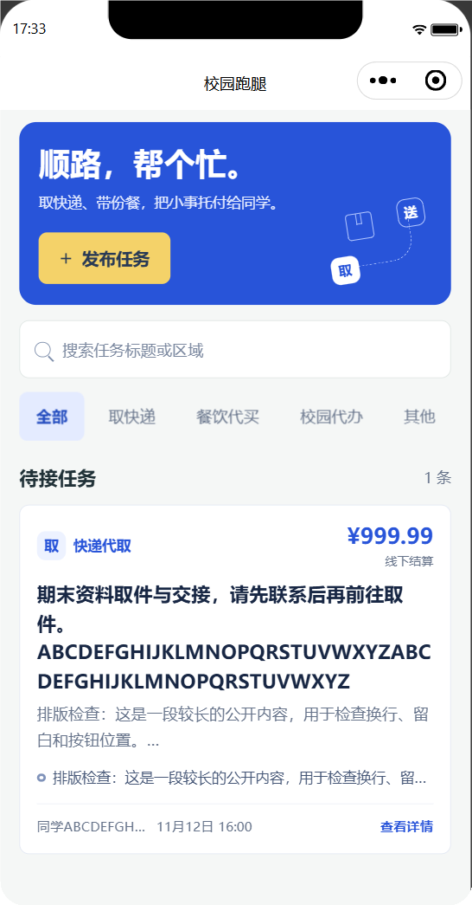
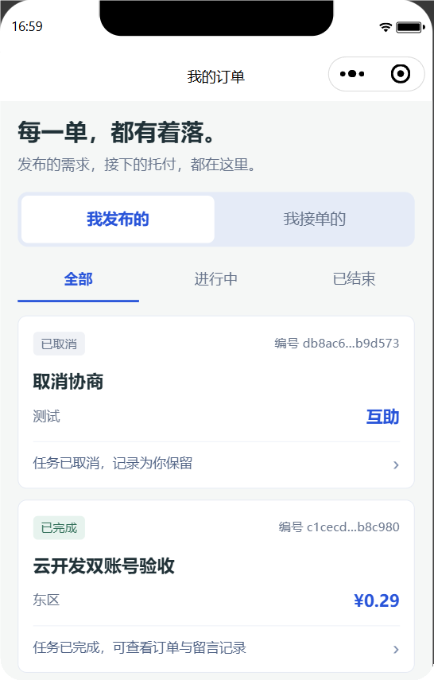
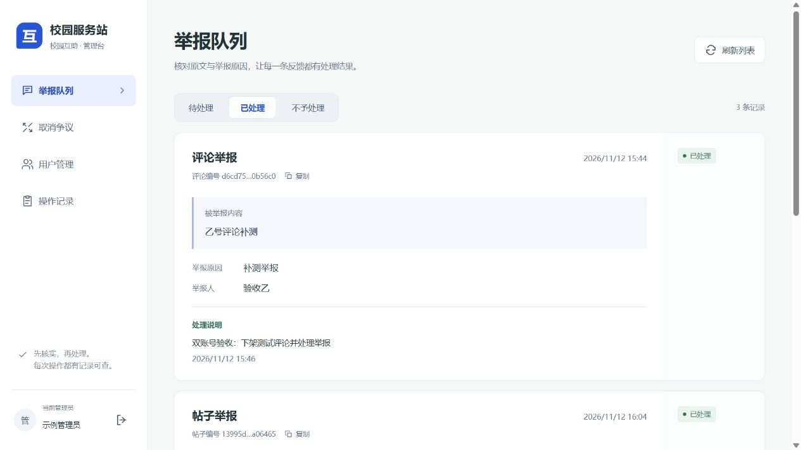
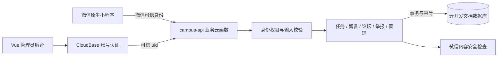
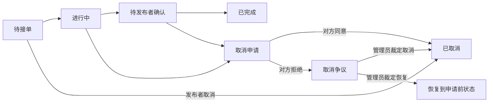

<div align="center">

# ORR · 校园互助

**顺路，帮个忙。**

面向单校区的校园跑腿与文字社区，基于微信原生小程序和微信云开发。

微信小程序 · CloudBase · Vue 3 · JavaScript

[功能介绍](#功能介绍) · [界面预览](#界面预览) · [快速开始](#快速开始) · [部署与版本同步](#部署与版本同步) · [项目文档](#项目文档)

</div>

---

## 项目介绍

ORR 将校园内的取件、带餐、代办需求，与接单、订单留言、完成确认和取消协商放在同一个小程序中。同时提供轻量的文字论坛，以及独立的管理员后台，处理内容举报和订单争议。

项目已从原来的独立服务端方案重构为**微信云开发架构**：小程序使用微信身份，业务通过 `campus-api` 云函数处理，数据存入云开发文档数据库。前端保留“校园服务站”的蓝白设计，以及留言防重复、失败保留草稿、请求乱序保护等已有修复。

当前定位是单校区、20–50 名同学的首轮试用。**任务报酬由双方线下结算，项目不包含微信支付、钱包或抽佣。**

## 功能介绍

### 微信小程序

| 模块 | 已实现的功能 |
| --- | --- |
| 跑腿大厅 | 分类浏览、搜索已加载任务、查看任务详情与报酬 |
| 发布任务 | 取快递、带餐、代办；分别填写大致区域和具体地点 |
| 接单与完成 | 一单一人；接单者标记完成，发布者确认完成 |
| 我的订单 | 区分我发布的、我接单的；按状态筛选，提示下一步操作 |
| 订单留言 | 仅订单双方可读写；防连续点击，失败保留草稿 |
| 取消协商 | 接单前直接取消；接单后由对方确认；分歧转管理员裁定 |
| 校园圈 | 文字发帖、浏览、评论和内容举报 |
| 我的举报 | 提交回执、本人举报历史、处理状态、处理说明与处理时间 |
| 我的 | 微信身份登录、昵称设置和订单快捷入口 |

### 管理员后台

| 模块 | 已实现的功能 |
| --- | --- |
| 举报队列 | 按待处理、已处理、不予处理筛选；核对原文和原因，处理或下架 |
| 取消争议 | 查看双方和取消原因，裁定取消或恢复任务 |
| 用户管理 | 按昵称搜索，封禁或解除封禁，填写处置原因 |
| 操作记录 | 回看操作人、处理对象、时间、结果和说明 |
| 通用交互 | 独立账号登录、完整编号复制、处理说明弹窗、窄屏适配 |

### 关键业务约束

- **地点隐私**：大厅和无关用户只能看到大致区域；具体地点仅对发布者和成功接单者返回。
- **并发一致性**：接单、状态变更、事件和幂等记录通过云端事务处理。
- **重复提交保护**：连续点击、网络重试和丢失响应后的重试复用请求编号，避免重复写入。
- **内容检查**：公开文本只有在微信内容安全检查明确通过后才发布。
- **权限隔离**：客户端不能直接读写数据库；管理员权限由云函数校验，处置操作留有审计记录。

完整规则及当前限制见 [产品规则](docs/product.md)。

## 界面预览

以下为校园跑腿首页、我的订单和管理员后台界面。小程序截图中的任务为测试示例，不代表真实交易。

<table>
  <tr>
    <th width="50%" align="center">校园跑腿首页</th>
    <th width="50%" align="center">我的订单</th>
  </tr>
  <tr>
    <td align="center" valign="top"></td>
    <td align="center" valign="top"></td>
  </tr>
  <tr><th colspan="2" align="center">管理员后台</th></tr>
  <tr>
    <td colspan="2" align="center"></td>
  </tr>
</table>

界面规范与不同尺寸的验证范围见 [前端设计](docs/frontend-design.md) 和 [验收记录](docs/acceptance.md)。

## 技术架构



| 层级 | 技术与职责 |
| --- | --- |
| 小程序 | 原生 JavaScript、WXML、WXSS；10 个业务页面 |
| 管理台 | Vue 3、Vite 6、CloudBase Web SDK |
| 业务服务 | `campus-api` 单一部署单元，内部按业务模块组织 |
| 数据存储 | CloudBase 文档数据库，10 个集合及声明索引 |
| 身份认证 | 小程序微信身份；管理台 CloudBase 用户名密码认证 |
| 一致性 | 数据库事务、请求幂等、有限冲突重试 |
| 构建与测试 | Node.js、内置测试运行器、esbuild、微信开发者工具 |

客户端统一通过服务层调用云函数，不依赖旧 Express、PostgreSQL、Docker 或自建 HTTP API。云函数保持模块化源码，部署时打包成独立入口。

### 任务生命周期



架构取舍、权限边界和事务设计见 [架构说明](docs/architecture.md)。

## 项目结构

```text
ORR/
├── miniprogram/                  微信原生小程序
│   ├── pages/                    跑腿、订单、论坛、个人中心、举报
│   ├── components/               任务卡片、状态标识、空状态
│   ├── services/                 统一云函数调用与业务适配
│   ├── utils/                    环境配置、校验、展示格式
│   └── assets/                   底部导航图标
├── cloudfunctions/campus-api/    业务云函数
│   ├── index.js                  可信身份与云端入口
│   ├── app.js                    action 分发、事务与幂等
│   ├── modules/                  用户、任务、留言、论坛、举报、管理
│   └── lib/                      存储、内容检查、校验、权限裁剪
├── admin/                        独立 Vue 管理台
│   └── src/                      操作界面、共用组件、云端调用
├── database/                     集合、权限与索引声明
├── scripts/                      项目检查、云函数打包、云端冒烟
├── tests/                        单元测试与模拟数据库集成测试
├── docs/                         产品、架构、部署、设计与验收
├── project.config.json           微信开发者工具配置
└── package.json                  本地验证命令
```

目录职责和新增模块约定见 [工程结构](docs/project-structure.md)。`.local/` 保存本机凭据、构建中间产物和验收证据；`.agents/` 是可选的本地 AI 开发技能目录。两者都不提交 Git，也不属于产品运行依赖。

## 快速开始

### 1. 准备环境

- Node.js **20 或以上**及 npm：用于本地安装、测试和构建。
- 微信开发者工具，以及已开通云开发的小程序 AppID。
- 有权限使用的 CloudBase 环境；管理台还需要已配置的管理员账号和云端角色。
- 私有仓库读取权限。当前只维护 `master` 分支。

> 本地 Node.js 版本不等于云函数运行时版本。现有测试环境的实测云端运行时及部署状态记录在 [部署说明](docs/cloudbase-setup.md)。

### 2. 获取源码并安装依赖

```bash
git clone https://github.com/lkuko/ORR.git
cd ORR

npm ci
npm --prefix admin ci
npm --prefix cloudfunctions/campus-api ci
```

### 3. 配置并运行小程序

仓库只保留 `YOUR_WECHAT_APPID`、`YOUR_CLOUDBASE_ENV_ID` 等占位符，不分发实际环境配置。首次使用时复制模板；已有本地配置不要覆盖：

```powershell
Copy-Item project.private.config.example.json project.private.config.json
Copy-Item miniprogram/utils/environments.example.js miniprogram/utils/environments.local.js
Copy-Item admin/.env.example admin/.env.local
```

1. 在以上三个本地文件中填写自己的 AppID 和 env ID。这些文件已被 Git 忽略。
2. 用微信开发者工具导入**工程根目录**，不要只导入 `miniprogram/`；私有配置中的 AppID 覆盖共享配置的占位符。
3. 在目标环境建立集合、索引和管理员角色，并部署业务云函数，不能只修改 env ID。
4. 编译后进入小程序。分别设置开发版、体验版环境；正式环境未准备好时保持 `release` 为空。

| 配置项 | 位置 | 说明 |
| --- | --- | --- |
| 小程序 AppID | `project.private.config.json` | 本地覆盖共享占位符，需与目标云环境绑定 |
| 小程序环境 | `miniprogram/utils/environments.local.js` | 分别配置 `develop`、`trial`、`release` |
| 管理台环境 | `admin/.env.local` | `VITE_CLOUDBASE_ENV`，构建时读取 |
| 云函数 AppID 绑定 | `project.private.config.json` 或 `WECHAT_APP_ID` 环境变量 | 打包时注入，环境变量优先；未配置时拒绝构建 |
| 集合与索引 | `database/collections.json` | 是本地声明，需在目标环境实际建立 |
| 云函数权限 | `cloudfunctions/campus-api/config.json` | 包含内容安全接口权限 |

示例文件、部署命令和验收文档中的标识都已替换为占位符。实际 AppID、env ID、站点地址和管理员凭据只在本机或云端配置；不要把 `.local/`、本地配置或构建产物打包分享。

### 4. 运行管理台

```powershell
# 已在上一步填写 admin/.env.local
npm --prefix admin run dev
```

开发服务启动后访问 http://127.0.0.1:5173。
使用已配置的管理员账号登录；普通微信用户不会自动获得网页管理员权限。管理员密码不随仓库分发。

### 5. 运行检查

```bash
npm run verify
```

该命令依次执行工程检查、本地自动化测试和管理台生产构建。测试使用模拟数据库，不代替真实云端或双账号手机验收。

## 部署与版本同步

**源码、管理台网站、小程序版本是三个独立的发布对象。推送或合并 GitHub 不会自动替换另外两者。** 当前仓库没有自动发布工作流。

| 对象 | 更新方式 | 验证方式 |
| --- | --- | --- |
| GitHub 源码 | 提交并推送 `master` | 核对本地与远端提交 |
| 业务云函数 | 运行 `node scripts/build-cloud.cjs`，部署 `.local/deploy/campus-api/` | 回读函数状态并执行云端冒烟 |
| 线上管理台 | 运行 `npm --prefix admin run build`，把 `admin/dist/` 发布到静态托管 `orr-admin/` | 核对线上资源版本、登录和模块读取 |
| 小程序 | 微信开发者工具编译、预览或上传 | 真机关闭调试验收；正式发布另行审核 |

管理台地址格式：`https://YOUR_CLOUDBASE_HOST/orr-admin/index.html`，请在 CloudBase 静态托管控制台查看自己的实际域名。测试域名可能先显示腾讯云访问提示。

2026-11-12 已将新版管理台同步到当时的测试环境，并核对线上 HTML、JS、CSS 与本地构建一致；管理员登录和四个管理模块读取通过。实际地址不随仓库分发。

静态托管发布范围只应覆盖 `orr-admin/`，保留平台认证文件和其他站点内容。云函数必须使用打包后的目录，不直接把仓库源码目录当作已验证的部署产物。

完整环境初始化、索引、权限、管理员配置和发布步骤见 [微信云开发部署](docs/cloudbase-setup.md)。

## 测试与验收

截至 **2026-11-12**，已有以下验证记录：

| 层级 | 验证范围与结果 |
| --- | --- |
| 本地自动化 | 38 项测试通过；10 页注册检查和管理台构建通过 |
| 权限与隐私 | 可信身份、精确地点裁剪、本人举报隔离、数据库直读写拒绝 |
| 事务与幂等 | 并发接单、重复留言、网络丢失响应后重试、事务回滚 |
| 真实双账号 | 关闭调试完成订单、取消协商、争议处理、论坛评论与举报闭环 |
| 跨网络 | B 账号切换移动网络并重进，可继续读取订单与留言 |
| 举报记录复核 | B 账号新版真机确认评论举报和处理结果可见，导航图标与编号显示正常 |
| 新版前端布局 | 管理台桌面及 375/320px 窄屏；任务工具栏模拟器检查通过 |

不同版本的验收范围分开记录。新界面的模拟器或浏览器检查，不能直接算作该版本已完成双账号手机验收。具体时间、问题修复和证据范围见 [验收记录](docs/acceptance.md)。

### 常用命令

| 命令 | 用途 |
| --- | --- |
| `npm run check` | 工程结构、页面注册及云开发配置检查 |
| `npm test` | 本地单元测试与业务集成测试 |
| `npm run build:admin` | 管理台生产构建 |
| `npm run verify` | 执行以上完整验证 |
| `node scripts/check-admin-hosting.cjs <实际管理台URL>` | 比较线上管理台与本地构建文件，也可用 `ORR_ADMIN_URL` 环境变量传入地址 |
| `node scripts/build-cloud.cjs` | 打包云函数部署目录 |
| `node scripts/cloud-smoke.cjs` | 连接开发者工具做真实云端冒烟，会创建并取消测试任务 |
| `node scripts/check-project.cjs --release` | 检查正式发布配置，未绑定正式环境时拒绝通过 |

## 常见问题

<details>
<summary><strong>为什么 localhost 和云端管理台界面不同？</strong></summary>

`127.0.0.1:5173` 运行的是本机 Vite 开发服务，读取当前源码。云端地址读取最近一次上传到静态托管的构建文件。修改代码、执行 Git 提交或者合并分支，都不会自动部署静态站点。

修改管理台后，需要重新构建并上传 `admin/dist/`，核对云端 `index.html` 引用的 JS/CSS 文件与本地产物一致。只有资源版本一致而页面仍旧时，再排查浏览器或 CDN 缓存。

</details>

<details>
<summary><strong>为什么开发版能用，正式版无法连接？</strong></summary>

当前只配置测试环境，`release` 环境为空是主动限制。正式发布前需要绑定独立正式环境、部署资源并重新验收，不应把测试环境直接当作正式发布配置。

</details>

<details>
<summary><strong>为什么接单前看不到具体地点？</strong></summary>

这是权限设计。公开区域用于判断任务是否顺路，具体地点只对发布者和成功接单者返回；前端隐藏不是唯一保护，云函数也会裁剪返回数据。

</details>

<details>
<summary><strong>举报评论后在哪里查看进度？</strong></summary>

提交成功后可点击“查看举报记录”，也可从“我的 → 我的举报”进入。这里只显示当前账号自己的举报，包含处理状态和管理员处理说明。

</details>

## 当前边界

- 支持单校区试用，暂不包含多校区、学生认证、支付、钱包、抽佣、实时聊天、图片上传、点赞和推荐算法。
- 首轮列表最多读取 100 条，留言和评论最多读取 200 条；任务搜索只针对已加载数据。
- 正式环境未绑定，小程序尚未正式发布；最新部署与体验版状态以 [验收记录](docs/acceptance.md) 为准。
- 维护分支为 `master`。后续变更应保留既有权限、状态机、幂等和隐私规则。

## 项目文档

| 文档 | 内容 |
| --- | --- |
| [产品规则](docs/product.md) | 功能范围、状态机和首轮限制 |
| [架构说明](docs/architecture.md) | 云开发选型、身份、权限、事务与幂等 |
| [工程结构](docs/project-structure.md) | 目录职责与模块组织 |
| [部署说明](docs/cloudbase-setup.md) | 环境配置、集合索引、云函数和管理台发布 |
| [前端设计](docs/frontend-design.md) | 校园服务站视觉规则与布局取舍 |
| [验收记录](docs/acceptance.md) | 本地测试、真实云端和双账号真机证据 |
| [简历项目描述](docs/resume-project.md) | 完整版、精简版、口述介绍及表述证据 |
| [技术学习指南](docs/technical-study-guide.md) | 架构、事务、幂等、权限、前端竞态与学习练习 |
| [面试一问一答](docs/interview-qa.md) | 60 道项目问题、参考答案与源码定位 |

## 文档参考

README 的信息组织参考了 [secondHandMiniprogram](https://github.com/vancece/secondHandMiniprogram/blob/main/README.md) 与 [CampusHub](https://github.com/badhope/campushub/blob/main/README.md) 的项目介绍、功能分组、目录及上手说明。本文内容、功能描述和截图均按 ORR 的实际实现整理，未引入参考项目的业务代码或界面素材。
