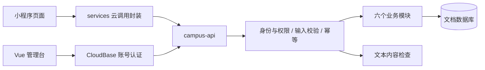

# ORR 项目技术学习指南

基线：`bdb831a`，核对日期：2026-11-12。先读 [简历描述](resume-project.md)，再结合本文阅读源码，最后用 [面试问答](interview-qa.md) 检查理解。

本文中的“当前实现”以源码为准，“验收结果”以 [验收记录](acceptance.md) 为准，“改进方向”表示尚未实现。示例中的 AppID、env ID 均使用占位符。官方资料用于解释基础概念，不能把新版文档中的所有 API 直接当作本项目锁定 SDK 的行为。

## 学习地图

| 路线 | 先掌握 | 再深入 |
| --- | --- | --- |
| 全栈主线 | [架构](#t01) → [调用链](#t02) → [身份](#t03) → [状态机](#t05) | [事务](#t06) → [幂等](#t07) → [部署](#t17) |
| 前端重点 | [登录与服务层](#t12) → [发送锁](#t13) → [响应乱序](#t14) | [Vue 管理台](#t15) → [测试](#t16) |
| 后端重点 | [权限裁剪](#t04) → [事务](#t06) → [幂等](#t07) | [冲突重试](#t08) → [封禁一致性](#t09) → [索引](#t11) |

### 先认识这些术语

| 术语 | 在本项目中怎样理解 |
| --- | --- |
| 事务原子性 | 一次接单涉及的关联写入，要么一起提交，要么不按成功提交处理 |
| ACID | 原子性、一致性、隔离性、持久性；数据库能力不能替代正确的业务校验，平台事务说明见 [R4] |
| 幂等 | 同一个操作编号的重复请求，复用原操作结果，而非产生额外写入 |
| 竞态 | 结果取决于异步操作完成顺序，例如旧列表晚回来覆盖新列表 |
| DTO / 响应视图 | 为接口构造的返回对象，只包含当前角色和场景需要的字段 |
| Promise | 表示异步结果；共用同一登录 Promise 可以合并正在执行的登录调用 |
| 快照 | 保存某个时刻的内容，例如举报提交时的公开摘要；不同于随后实时查询原文 |
| 哈希与加密 | 哈希用于摘要/标识，加密用于可授权恢复的保密；两者都不等于业务授权 |
| QPS / P95 | 每秒请求量 / 95% 样本不超过的延迟值；12 路同时请求不等于测得 QPS 或 P95 |
| 服务端与客户端 | 云函数处于服务端边界；小程序和浏览器都属于需要验证身份与权限的客户端 |

<a id="t01"></a>
## 1. 架构：模块化云函数为什么适合这个项目

**先理解概念。** 云函数把运行基础设施交给平台管理，但业务代码仍然要考虑权限、错误、超时、依赖、数据一致性和部署。Serverless 不等于没有后端，也不等于天然没有运维成本。参考官方资料 [R1]。

**当前实现。** 小程序负责用户交互；`miniprogram/services/` 负责云函数调用；`campus-api` 是一个部署单元，内部划分 `users/tasks/messages/forum/reports/admin` 六个模块；Vue 管理台处理管理操作。业务数据写入文档数据库，客户端不直接访问集合。



为什么不拆六个微服务：目前业务规模小，接单、用户在途任务、事件及幂等记录需要协同提交；过早拆分会增加调用、发布和一致性处理成本。模块边界可先在代码中形成，出现独立扩缩容或权限隔离需求时再讨论拆服务。

**边界。** 当前是模块化单体云函数，不是微服务。平台能创建多个实例，也不会自动消除热点文档竞争。

**读代码：** [入口](../cloudfunctions/campus-api/index.js)、[路由聚合与分发](../cloudfunctions/campus-api/app.js)、[架构决定](architecture.md)。

<a id="t02"></a>
## 2. 沿一次接单请求看完整调用链

```text
任务详情 accept()
→ 用户确认 → perform('accept')
→ services/tasks.action()
→ services/cloud.mutate()
→ wx.cloud.callFunction({ action, data, requestId })
→ 云端入口获取平台身份
→ createHandler：鉴权、操作摘要、幂等查找
→ store.transact：重新读取身份与任务
→ tasks.accept：检查状态和角色
→ saveTask：保存任务、在途任务 ID、事件
→ 保存幂等结果 → 提交事务
→ taskView 裁剪后的结果 → 页面更新
```

请求形状是 `{ action, data, requestId }`，业务响应是 `{ ok: true, data, meta }` 或 `{ ok: false, error: { code, message } }`。`action` 对应本项目显式注册的处理器；它不是任意函数执行入口。

平台调用成功不等于业务成功：SDK 返回了响应，还要检查 `response.result.ok`。网络异常由客户端转换为 `TRANSPORT_ERROR`；业务校验返回稳定错误码，方便区分是否应该保留重试编号。

**学习目标。** 在不运行程序的情况下，能指出“请求在哪一步验证身份、在哪一步写数据库、在哪一步变成页面上的任务对象”。

**读代码：** [详情页](../miniprogram/pages/tasks/detail/index.js)、[任务服务](../miniprogram/services/tasks.js)、[云调用](../miniprogram/services/cloud.js)、[处理器](../cloudfunctions/campus-api/app.js)。

<a id="t03"></a>
## 3. 认证、授权与稳定用户标识

认证回答“调用者是谁”，授权回答“这个调用者能做什么”。请求参数里的 `userId`、`openid`、`role` 都可以被调用方修改，因此不能拿来证明身份。

**当前实现：**

- 小程序身份取自云端 SDK 上下文；校验 AppID 与服务端配置一致，再生成内部用户 ID。
- `userId = SHA256('wechat', appid, openid)`；实现会用空字节分隔各部分。命名空间和分隔符用于避免不同来源/组合的简单拼接歧义。
- 网页管理台先通过 CloudBase 账号认证，云函数读取平台 uid，再检查 `admin_users` 中对应记录是否为 `ACTIVE`、`ADMIN`。
- 用户身份哈希用于稳定标识和减少原始 OpenID 的直接传播，不是加密、登录令牌或匿名化保证。知道一个 ID 不等于拥有它的权限。
- 当前角色模型是普通用户/管理员和资源关系校验，不是完整的多角色 RBAC 管理平台。

**边界。** 单元测试可以验证“不相信请求参数”，但云端入口可信上下文是否正确仍需真实 SDK 与真实调用渠道验收。没有学生认证，微信账号登录不能证明在校身份。

**读代码：** [入口](../cloudfunctions/campus-api/index.js)、[userId / actorKey / actor](../cloudfunctions/campus-api/app.js)、[管理台认证](../admin/src/api.js)。平台入口权限与函数内部业务授权是不同层次，参考 [R2]。

<a id="t04"></a>
## 4. 数据隐私：控制返回值比隐藏按钮更重要

**当前实现。** 数据库集合声明为客户端不可直接读写。小程序和网页通过云函数访问；云函数有访问数据库的能力，因此仍要自行检查当前账号、资源关系和操作权限。[R3] 解释数据库安全规则。

任务列表通过 `taskView(task, actorId, true)` 强制使用公开视图，具体地点返回 `null`。任务详情只有发布者或接单者才能得到具体地点、取消原因。留言接口单独检查是否为订单参与者，不能因为“知道 taskId”就读取。

```js
// 摘自实现，省略其他字段。
const privateAccess = !publicOnly && participant(task, userId)
return {
  exactLocation: privateAccess ? task.exactLocation : null,
  canSeeExactLocation: privateAccess
}
```

这相当于按场景构造响应 DTO：响应只含该页面和角色需要的字段。用 CSS 隐藏、前端条件渲染或缩短 ID 都不构成授权。

**练习。** 为任务列表、本人详情、陌生人详情分别写断言；再尝试直接调用留言接口。期望是返回内容确实被裁剪或请求被拒绝，而非页面“看上去没显示”。

**读代码：** [视图裁剪](../cloudfunctions/campus-api/lib/views.js)、[留言权限](../cloudfunctions/campus-api/modules/messages.js)、[数据库访问说明](../database/access-rules.md)。

<a id="t05"></a>
## 5. 用状态机表示订单规则

状态机由“当前状态、动作、操作人、前置条件、下一状态”组成。它可以把页面上分散的业务规则收敛为服务端可检查的转换。

| 当前状态 | 动作与角色 | 下一状态 |
| --- | --- | --- |
| `OPEN` | 非发布者接单，任务可见且未过期 | `ASSIGNED` |
| `OPEN` | 发布者取消 | `CANCELLED` |
| `ASSIGNED` | 接单者提交完成 | `COMPLETION_PENDING` |
| `COMPLETION_PENDING` | 发布者确认 | `COMPLETED` |
| `ASSIGNED` / `COMPLETION_PENDING` | 任一参与者申请取消 | `CANCEL_PENDING` |
| `CANCEL_PENDING` | 另一方同意 / 拒绝 | `CANCELLED` / `CANCEL_DISPUTED` |
| `CANCEL_DISPUTED` | 管理员裁定 | `CANCELLED` 或恢复申请前状态 |

`cancelResumeStatus` 保存申请取消前状态，所以恢复不是一律回到“进行中”。`visibility` 与订单 `status` 分开：一个表达是否公开，另一个表达业务进程。

**不变量示例：** 一条任务最多有一个接单者；只有发布者确认最终完成；取消申请人不能自己批准；只有进入争议状态才允许管理员裁定。

**边界。** 代码检查截止时间来过滤大厅、拒绝过期接单，目前没有定时任务自动把过期订单改成独立 `EXPIRED` 状态。

**读代码：** [任务动作](../cloudfunctions/campus-api/modules/tasks.js)、[管理员裁定](../cloudfunctions/campus-api/modules/admin.js)、[状态提示](../miniprogram/utils/task-ui.js)。

<a id="t06"></a>
## 6. 事务接单与多文档一致性

**先理解概念。** 多个数据库更新需要一起成功或失败时，事务可以提供原子提交边界；并发场景还必须正确处理读取、冲突和重试，不能只给几条写操作套一个事务就认为所有竞争都解决了。CloudBase 的事务机制与限制见 [R4]。

假设两个调用都想接任务 T。错误实现是先在事务外读出 `OPEN`，然后各自写接单人；两次读都可能成功。ORR 在每次事务尝试中重新读取任务，再校验 `OPEN`、可见、未过期、参与者有效，之后更新相同任务文档。

冲突失败的一方重新尝试时会看到最新状态；若已被接单，返回 `TASK_NOT_OPEN`，而不是继续覆盖接单者。

一次接单的提交边界包括：

1. 任务状态和接单者。
2. 参与者的 `activeTaskIds`、用户修订号。
3. `task_events` 中的事件。
4. 当前写请求对应的 `idempotency` 记录和业务结果。

`saveTask` 在传入的事务 store 上操作；事件 ID 由操作标识、任务 ID 和事件类型生成。任何一部分失败，会使本次事务不能按成功提交处理。

**验证证据。** 本地测试为 12 个不同模拟身份争抢；真实云端复测是一个接单账号发起 12 个不同请求编号，另一个账号发布任务。两者均验证了“一次成功”，但没有测出服务最大吞吐量。

**读代码：** [事务适配器](../cloudfunctions/campus-api/lib/store.js)、[saveTask](../cloudfunctions/campus-api/lib/task-records.js)、[并发与回滚测试](../tests/integration/business.test.js)。

<a id="t07"></a>
## 7. 幂等：解决“写成功但没收到响应”

**问题场景。** 用户点发送，服务器已落库，返回包却丢失。客户端看到超时后再发一次。如果两次都被当作新操作，会产生两条留言。按钮防重复只能减少连续点击，不能解决这个问题。

**当前实现分三层：**

| 层级 | 保存/判断的内容 | 解决的问题 |
| --- | --- | --- |
| 页面 | 发送中的同步锁 | 同一页面快速重复触发 |
| 小程序服务层 | 按环境、用户、动作、载荷指纹保存待确认请求编号 | 网络失败和重启后复用编号 |
| 云端 | 身份绑定操作 ID、参数摘要、已提交结果 | 重放结果、拒绝编号被复用于不同参数 |

```text
operationId = SHA256(身份类型, 可信 actorId, requestId)
digest      = SHA256(action, canonical(data))

已有 operationId 且摘要相同 → 返回保存的结果
已有 operationId 但摘要不同 → IDEMPOTENCY_CONFLICT
尚无记录 → 内容检查 → 事务内再次查重 → 写业务与结果 → 提交
```

`canonical` 对对象键排序、递归序列化；数组顺序保留。它减少相同 JSON 对象因键顺序不同造成的摘要差异，不是对任意 JavaScript 对象的通用序列化器。

必须在事务内再次查幂等记录：两个请求可能同时通过事务外的“没有记录”检查。如果业务写入和幂等记录分开提交，进程在两者之间失败仍会产生重复风险。

**请求编号何时清理：** 成功后清理；明确业务错误后清理；`TRANSPORT_ERROR`、`INTERNAL_ERROR`、`BUSY` 保留，以便不确定结果时重试。客户端存的是未确认请求编号；小程序载荷指纹不是加密存储，也不是鉴权凭据。

**边界与改进：** 当前没有幂等记录 TTL/归档；持久化结果可能随业务状态变化变旧，重放读取策略需按数据敏感性继续审视。使用新请求编号重复提交相同内容会被视为新操作，因此它不是“相同文字永远只出现一次”，也不等于网络协议层的 exactly-once。

**读代码：** [小程序 mutate / fingerprint](../miniprogram/services/cloud.js)、[云端幂等](../cloudfunctions/campus-api/app.js)、[canonical / hash](../cloudfunctions/campus-api/lib/validation.js)。

<a id="t08"></a>
## 8. 冲突重试、退避与错误分类

`store.transact` 最多执行 7 次尝试，包括首次。事务开始、业务读写或提交阶段出现冲突都进入同一捕获逻辑；可用的事务会尝试回滚。

```js
// 当前退避公式；attempt 从 0 开始。
Math.min(40 * (2 ** attempt), 500) + Math.floor(Math.random() * 50)
```

指数增长减少高频重试，最多 500 ms 的基础等待限制单次退避，0–49 ms 抖动减少多个请求同步重试。这里只重试识别出的数据库写冲突；参数错误、权限错误等 `AppError` 直接抛出，未知错误也不盲目重试。最后仍冲突返回 `BUSY`。

真实测试曾出现 SDK 错误文本 `ResourceUnavailable.TransactionConflict` 未被正确分类，后来补入识别并增加回归测试。不要因为同一个外层错误码也可能表示冲突，就把所有系统错误都归为可重试。

**限制。** 有限重试不是限流，不保证高并发时每个请求都成功。`revision` 字段也不是本项目自写的 `WHERE revision=旧值` CAS；这里仍依赖数据库事务冲突机制。

**读代码：** [isConflict / transact](../cloudfunctions/campus-api/lib/store.js)、[错误分类测试](../tests/unit/cloud.test.js)。

<a id="t09"></a>
## 9. 封禁、留言与订单结束之间的竞争

**封禁竞争。** 只在事务前检查用户为 `ACTIVE` 会留下窗口：检查通过后管理员可能封禁用户，旧请求却继续写。ORR 在写事务内再次读取操作人，并写其修订号，使业务写入与封禁操作对相同用户文档产生竞争。

任务变更会维护参与者的 `activeTaskIds`，封禁时按这些 ID 查任务：未接单任务下架取消，在途任务进入争议，恢复前检查双方账号有效。该维护与任务变更同事务进行。

**留言竞争。** 发送留言检查任务不是 `COMPLETED/CANCELLED`，然后同时递增任务 `messageRevision`、写留言。如果只读任务却单独写留言，结束订单的事务和留言事务可能写不同文档；触碰共同任务文档是让两者竞争的关键。

**规模边界。** 所有写操作都触碰操作人文档，会在同一用户高频操作时产生额外争用；用户在途 ID 数组和批量封禁事务也会随任务数量增长。扩大规模前，应评估文档大小、事务执行时间以及分批治理方案，不能声称当前设计支持无限在途任务。

**读代码：** [处理器事务](../cloudfunctions/campus-api/app.js)、[在途任务维护](../cloudfunctions/campus-api/lib/task-records.js)、[留言](../cloudfunctions/campus-api/modules/messages.js)、[封禁](../cloudfunctions/campus-api/modules/admin.js)。

<a id="t10"></a>
## 10. 内容检查、举报快照与管理员审计

### 内容检查的时机

写路由用 `prepare` 规范化字段，用 `content` 声明待检查文本。`msgSecCheck` 明确返回成功且 `suggest === 'pass'` 才继续；服务异常返回 `CONTENT_CHECK_UNAVAILABLE`，其他未通过结果返回 `CONTENT_REJECTED`。当前没有待审核发布队列，审核不确定不会先展示。

外部内容检查放在数据库事务外，减少事务持有时间；真正落库前仍在事务内重新校验业务状态。两个首次并发的相同请求仍可能都做一次内容检查，幂等保证的是提交结果，不保证外部检查恰好执行一次。

### 举报为什么要存快照

内容被下架后，举报人仍需要看到自己举报了什么。当前记录保存最多 160 字的提交时公开摘要；评论还检查父帖是否可见。旧记录没有摘要时返回空摘要，由前端显示类型和缩略编号，不为补历史展示而重新公开隐藏内容。

`reports.mine` 固定用服务端 `ctx.actor.id` 过滤 `reporterId`，返回字段不含其他举报人或处置管理员身份。前端有举报成功回执及“我的举报”长期入口。

### 审计与整体流程的区别

单个管理员写动作和它的审计记录在同一事务内。但页面上的“下架并结案”先调用 `admin.hide`，再调用 `admin.resolveReport`，是两个独立请求，不能宣称整个按钮动作跨两次调用原子化。若第一步成功、第二步失败，应保留已下架事实并重试/补做结案；未来可设计组合服务端动作或可恢复流程。

**读代码：** [内容检查](../cloudfunctions/campus-api/lib/content-guard.js)、[举报](../cloudfunctions/campus-api/modules/reports.js)、[管理动作](../cloudfunctions/campus-api/modules/admin.js)、[hideReportedContent](../admin/src/App.vue)。

<a id="t11"></a>
## 11. 文档建模、复合索引、金额与时间

### 集合职责

| 集合 | 存储对象 |
| --- | --- |
| `users` / `admin_users` | 两类主体及业务状态/角色 |
| `tasks` | 任务及当前业务状态 |
| `task_messages` / `task_events` | 参与者留言 / 状态变化事件 |
| `posts` / `comments` | 论坛帖子和评论 |
| `reports` / `admin_action_logs` | 举报处理过程 / 管理动作留痕 |
| `idempotency` | 操作摘要及成功结果 |

昵称保存在任务、帖子、留言中作为提交时快照。好处是展示时少查用户；代价是改名后历史显示不自动更新。身份关系始终使用 ID，不能用昵称判断归属。

### 查询与索引对应

“我的举报”按 `reporterId` 等值过滤，再按 `createdAt DESC` 排序，因此声明了该组合索引。“我的订单”分别使用 `ownerId/updatedAt` 或 `helperId/updatedAt`。本地 JSON 是声明，不证明云端已建立；需要部署、回读并实测查询。

当前大厅读取最近最多 100 条；留言读取最近最多 200 条后反转展示；任务搜索只过滤已加载数据。后续若做游标分页，应讨论稳定排序和相同时间值的补充排序键，不能把增加 `limit` 当作完整分页。

### 金额和时间

金额由十进制文本分段解析为整数分，例如 `"0.29" → 0×100+29`，不是依赖浮点 `0.29*100`。入库为 `rewardCents`，显示转换为两位小数字符串；没有支付或账本系统。

时间使用 ISO 字符串，正常写路径统一格式。代码会比较格式一致的 ISO 时间字符串；这不意味着任意时间格式都能按字符串正确比较。截止时间在输入及业务执行中校验，展示时再按界面需要格式化。

**读代码：** [集合与索引](../database/collections.json)、[money / amount](../cloudfunctions/campus-api/lib/validation.js)、[任务列表](../cloudfunctions/campus-api/modules/tasks.js)、[留言列表](../cloudfunctions/campus-api/modules/messages.js)。

<a id="t12"></a>
## 12. 小程序登录合并与服务层职责

`ensureLogin` 有两个不同层次：`globalData.user` 是已取得用户信息的内存缓存；`loginPromise` 是正在执行的登录请求。多个页面同时调用时，共用同一个 Promise，避免同时发起重复登录。失败后在 `finally` 清空 Promise，允许下一次重新尝试。

缓存用户信息不表示云端授权永久有效。业务云函数仍会检查用户状态；封禁后，即使页面还拿着旧资料，业务写请求也不能依赖它放行。

服务层把云调用、环境选择、错误转换、幂等编号处理从页面抽离。页面主要表达用户动作和 UI 状态，服务文件表达接口意图；测试可以替换云传输，同时仍执行真实页面逻辑。

**练习。** 在模拟云登录中计数，同时执行两次 `ensureLogin()`，断言只调用一次登录接口，再模拟一次登录失败，验证下一次仍可重新调用。

**读代码：** [应用入口](../miniprogram/app.js)、[云调用封装](../miniprogram/services/cloud.js)、[对应测试](../tests/unit/cloud.test.js)。

<a id="t13"></a>
## 13. 防重复发送与失败草稿保留

详情页在发请求前立即设置实例字段 `this.sendingMessage = true`。这是处理下一次事件的同步判断；`setData({ sendingMessage: true })` 负责显示发送状态。不要把“按钮看起来变灰”视为唯一防重复保证。

```js
// 概念化摘录，完整错误处理见源码。
if (this.sendingMessage) return this.sendPromise
this.sendingMessage = true
this.sendPromise = send(content)
  .then(message => {
    // 确认成功后才清草稿，并按服务端 ID 去重后追加。
    this.setData({ message: '', messages: merge(this.data.messages, message) })
  })
  .finally(() => { this.sendingMessage = false })
```

实际代码只在成功分支清空输入，失败只提示错误，所以当前页面中的草稿仍在。发送期间也阻止输入修改，避免“用户已输入下一段，旧发送成功后却把新输入清掉”。页面退出后的草稿恢复没有实现，不要把它说成草稿永久持久化。

这是以服务端确认结果更新页面，不是先显示假成功的乐观写入；可避免一次额外全量查询，但列表最终仍可刷新校对。

**读代码：** [sendMessage](../miniprogram/pages/tasks/detail/index.js)、[留言 UI 测试](../tests/unit/miniprogram-ui.test.js)。

<a id="t14"></a>
## 14. 请求乱序为什么会覆盖新界面

用户先选 A 类，再选 B 类；A 请求慢，B 请求快。若不加判断，B 先渲染后，A 的旧结果到达又把界面改回 A。

当前做法是每发起一次加载就递增序号，闭包保存本次序号；结果只有属于最新请求才应用。旧请求的失败和 `loading` 更新也要检查序号，否则旧错误仍可能盖住新成功。

```js
const request = ++this.requestId
const rows = await loadRows()
if (request !== this.requestId) return
this.setData({ rows, loading: false })
```

留言还有一种更隐蔽的竞态：旧列表请求发起后，新留言发送成功并追加；随后旧列表返回，不包含新留言。详情页发送时会递增 `messagesRequestId`，让发送前启动的读取失效。

**区别。** 请求序号用于“只接受最新界面结果”；幂等请求编号用于“同一个业务写操作可安全重试”。二者不能混用。序号丢弃结果也不等于取消了网络请求，云端开销可能已经发生。

**读代码：** [任务列表](../miniprogram/pages/tasks/list/index.js)、[详情留言](../miniprogram/pages/tasks/detail/index.js)、[举报历史](../miniprogram/pages/report/list/index.js)、[管理台 loadRequest](../admin/src/App.vue)。

<a id="t15"></a>
## 15. Vue 管理台、组件与窄屏布局

管理台使用 Composition API：`ref` 保存登录状态、筛选项、列表、弹窗状态，`computed` 派生当前导航和排序后的审计列表。脚本中通常通过 `.value` 访问 ref，模板在相应场景会解包；DOM 更新是批处理的，操作刚渲染出的弹窗前使用 `nextTick`。基础机制见 [R5]。

`token` 变量在这个组件中是布尔登录标记，不是自行签发的 JWT；认证会话由 CloudBase SDK 管理。项目没有引入 Pinia 或 Vue Router，不要凭 Vue 技术栈推断用了它们。

`RecordId.vue` 统一缩略显示与完整值复制；剪贴板失败时给出可选择的完整编号。布局修复需要同时处理容器最小宽度、换行和按钮布局，而不是仅把文字变小。短编号只改变展示，网络和数据库仍使用完整字符串 ID。

管理员操作锁覆盖“弹窗询问 → 发起请求 → 完成/失败”，取消弹窗后释放锁。后台写请求用 `sessionStorage` 保存待确认编号及 `JSON.stringify(data)` 指纹，和小程序只存编号的策略不完全一样；当前该指纹包含载荷文本，应作为本地存储最小化的后续优化点。

另一个扩展点是举报列表：目前先查队列，再为每条举报读取对象详情，形成 1+N 次云调用。可以考虑服务端批量返回经权限裁剪的对象摘要，但尚未实现。

**读代码：** [主组件](../admin/src/App.vue)、[编号组件](../admin/src/components/RecordId.vue)、[API 层](../admin/src/api.js)、[样式](../admin/src/style.css)。

<a id="t16"></a>
## 16. 怎样设计能证明问题的测试

本项目用 Node.js 自带 `node:test` 与 `node:assert/strict`，不是 Jest。当前本地重新运行得到 38/38 通过；测试命令见 [package.json](../package.json)，测试运行器概念见 [R6]。

| 测试层 | 方法 | 能证明 | 不能替代 |
| --- | --- | --- | --- |
| 校验/适配器单元测试 | 输入边界、模拟 SDK 错误、事务生命周期 | 金额校验、错误分类、重试策略 | 平台真实 SDK 行为 |
| 业务集成测试 | 调用真实处理器，注入内存 store | 角色规则、回滚、幂等、状态转换 | 云数据库事务隔离实测 |
| 页面交互测试 | VM 加载页面和 services，控制 Promise 完成顺序 | 防重复、草稿、旧响应保护 | 真机布局及网络环境 |
| 云端冒烟/真机验收 | 真实账号、SDK、管理台和数据库核对 | 实际部署链路与指定业务场景 | 未执行场景与压力容量 |

内存 store 用全局 revision 和快照模拟冲突重试，比真实数据库更粗粒度，不能据此推断平台锁实现或实际性能。

推荐学习的故障注入：

1. 让服务端成功提交后，客户端收到模拟超时；重新创建客户端实例，用相同本地存储重试，确认一条记录。
2. 暂存第一个列表请求的 resolve，先完成第二个请求，再完成第一个，确认新结果不变。
3. 在任务保存流程中注入一次存储失败，确认任务和用户在途 ID 都没有部分提交。
4. 用陌生账号或伪造角色字段请求管理动作，确认被拒绝。

**读代码：** [业务测试](../tests/integration/business.test.js)、[UI 测试](../tests/unit/miniprogram-ui.test.js)、[内存 store](../tests/helpers/memory-store.js)、[VM 页面加载器](../tests/helpers/miniprogram.js)。

<a id="t17"></a>
## 17. 配置、构建与发布是三件不同的事

**当前配置方式。** 共享源码只有 `YOUR_WECHAT_APPID`、`YOUR_CLOUDBASE_ENV_ID` 等占位符。私有 AppID、环境映射、管理台 `.env.local` 都被 Git 忽略；云函数打包从私有 AppID 或 `WECHAT_APP_ID` 读取绑定值。缺失配置时应中止或拒绝调用，不默默回退到某个固定环境。

**重要区别。** Vite 的 `VITE_*` 值会进入客户端构建产物，因此 `.env.local` 被 Git 忽略，只解决源码误提交，不会使前端使用的值变成秘密。AppID/env ID 是运行标识，不能充当授权；真正的密钥和管理员密码不能放入 `VITE_*`。官方说明见 [R7]。

云函数曾出现相对依赖丢失，当前用 esbuild 合并业务代码成独立入口，将 SDK 保留为外部依赖，由部署目录的 package 文件管理。构建产物放在 `.local/deploy/campus-api/`，不能把“源码文件都在本地”当作“线上包一定完整”。

源码推送、管理台静态发布、云函数部署、小程序预览/上传是独立动作。管理台不一致时，先比较线上 HTML 引用的资源名，再比较实际 JS/CSS 的 SHA-256；发现资源 404 或哈希不同，先处理发布问题，不先归因于缓存。

**历史边界。** `.gitignore` 不会移除已跟踪内容，也不会删除旧提交。上次清理只更新当前版本，旧历史未重写。学习文档也不应重新填入真实环境标识。

**读代码：** [配置步骤](../README.md)、[云函数打包](../scripts/build-cloud.cjs)、[托管比对](../scripts/check-admin-hosting.cjs)、[构建配置](../admin/vite.config.js)、[忽略规则](../.gitignore)。

<a id="t18"></a>
## 18. 可观测性、性能与诚实描述

当前记录 `action`、成功标记、错误码、服务端耗时、数据库计时、内容检查计时；开发版客户端补充总调用耗时。代码不把正文、具体地点或身份对象直接写进这些性能日志。

`coldStart` 是当前处理器实例首次处理请求的标记，不是直接测得的冷启动持续时间；`serverMs` 从处理器开始计时，不涵盖所有平台初始化与网络开销。`databaseMs` 是部分 store 方法耗时累计，不完整覆盖事务开始、提交、退避，所以不能把各字段机械相加解释所有延迟。

项目记录过少量真实云端耗时样本，但没有足够样本形成平均、P95、P99 或优化前后对照。并发测试验证竞争结果，压力测试还要观察持续吞吐、延迟分布、错误率、资源和成本。

**改进方向，尚未实现：** 游标分页与真正的服务端搜索；幂等记录生命周期；管理员举报对象批量查询；分批封禁处理；明确的限流策略；请求链路标识与指标聚合；运行时升级和正式环境验收。

这些改进应先通过数据判断优先级，不为了简历堆入 Redis、MQ 或分布式锁。若新需求是支付，需要单独设计回调鉴权、支付状态、对账与退款，不能直接把现有线下报酬当作支付系统。

**读代码与证据：** [timedStore / meta](../cloudfunctions/campus-api/app.js)、[客户端计时](../miniprogram/services/cloud.js)、[验收记录](acceptance.md)。

## 19. 七次学习练习

| 次序 | 阅读与练习 | 完成标准 |
| --- | --- | --- |
| 1 | 从详情页追踪接单，画出调用链 | 能指出每个边界的数据形状和失败分支 |
| 2 | 阅读状态机，列出非法动作 | 能写出“自己接自己单”“自己批准取消”的拒绝测试 |
| 3 | 阅读事务与 saveTask，模拟两个接单请求 | 能解释哪一个共同文档导致竞争，为什么必须重读 |
| 4 | 模拟写入成功但返回丢失 | 重启模拟客户端后重试，仍只保存一条留言 |
| 5 | 手动控制两个 Promise 的完成顺序 | 旧响应与旧错误都不能覆盖新页面 |
| 6 | 阅读举报与管理员处置 | 能指出摘要隐私规则及两次管理调用的事务边界 |
| 7 | 使用配置模板、运行测试、检查构建脚本 | 能解释 Git、静态站点、云函数、小程序各自如何发布 |

以上故障注入优先在本地测试完成。真实云端冒烟脚本会创建并取消测试任务，执行前应明确账号、环境和清理方式；不要把生产数据当练习样本。

## 20. 官方资料与阅读方法

以下仅选官方资料，2026-11-12 查阅。平台模式、SDK 和运行时可能变化；本项目使用文档数据库及已锁定依赖，不把新文档中的 PG 模式或其他 SDK 接口自动套入现有代码。

- [R1：CloudBase 云函数](https://docs.cloudbase.net/cloud-function/develop)：理解平台负责什么、业务代码负责什么。
- [R2：云函数访问控制](https://docs.cloudbase.net/cloud-function/security-rules)：区分入口控制与函数内业务鉴权；本文没有声称项目已配置所有新策略功能。
- [R3：数据库安全规则](https://docs.cloudbase.net/database/security-rules)：理解客户端访问边界。
- [R4：数据库事务](https://docs.cloudbase.net/database/transaction)：理解原子提交、冲突和平台限制；实际重试策略阅读本项目 store。
- [R5：Vue 响应式基础](https://vuejs.org/guide/essentials/reactivity-fundamentals.html)：理解 ref 与 DOM 更新时机。
- [R6：Node.js Test runner](https://nodejs.org/api/test.html)：理解测试执行、异步断言和模拟；注意所安装 Node 版本支持的功能。
- [R7：Vite 环境变量与模式](https://vite.dev/guide/env-and-mode)：理解构建期替换及客户端变量暴露。

建议每看完一节官方文档，回到本文给出的本项目源码位置，回答“这里实际用了哪个能力、未使用哪个能力、如果失败会怎样”。
